<div align="center">


# متتبّع السجلات · Records Tracker

**حوّل أي هدف إلى رحلة من الخطوات، محفوظة في ملفات تملكها أنت.**

[English](README.md) · **العربية**

[](https://github.com/ASSOLI99/records-tracker/actions/workflows/ci.yml)


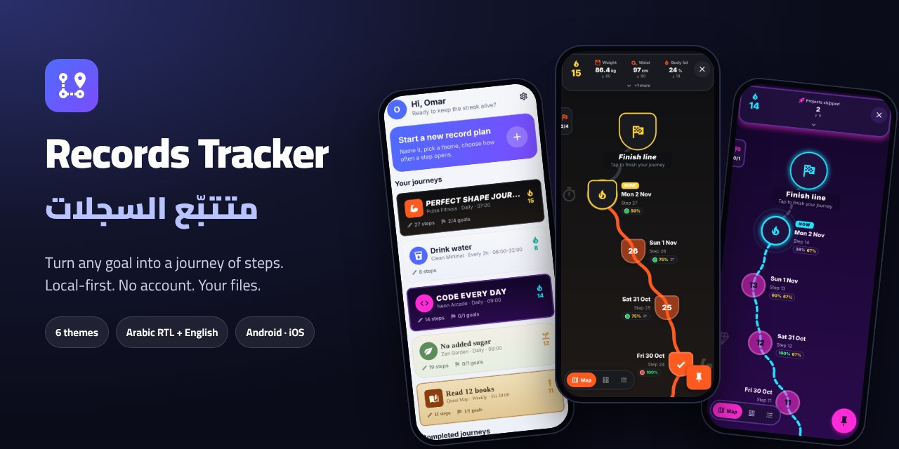

</div>

<div dir="rtl">

## الفكرة

معظم تطبيقات العادات تعطيك مربع اختيار وتقويمًا. أما «متتبّع السجلات» فيعطي كل هدف **رحلة**
خاصة به: مسارًا يكبر خطوة بعد خطوة، مثل خريطة المراحل في الألعاب.

- أنت تحدد **متى تُفتح خطوة جديدة**: كل يوم، أو كل ساعتين، أو في أيام النادي فقط، أو عندما تضيفها بنفسك.
- أنت تحدد **ماذا تملأ في كل خطوة**: المزاج، والملاحظات، وقائمة مهام، وأرقامًا لها أهداف، ونعم/لا، وصورًا.
- تشاهد المسار يكبر، وتحافظ على **سلسلة الأيام** 🔥، وتتابع **حالاتك** (مثل الوزن أو المدخرات)
  مقارنةً بالهدف، وتُنجز **أهداف الرحلة** واحدًا تلو الآخر.

التطبيق **يعمل محليًا بالكامل**: لا حساب، ولا خادم، ولا تتبّع. كل شيء يُحفظ كملفات JSON عادية في
مجلد واحد اسمه `record-tracker` على هاتفك، ونسخه الاحتياطي يكون بنسخ هذا المجلد إلى Google Drive
أو iCloud أو حاسوبك.

والتطبيق **ثنائي اللغة**: العربية والإنجليزية، مع واجهة كاملة من اليمين إلى اليسار، وخط Cairo
للعربية، وتبديل فوري للغة دون إعادة تشغيل.

## لقطات الشاشة

</div>

<table>
  <tr>
    <td align="center">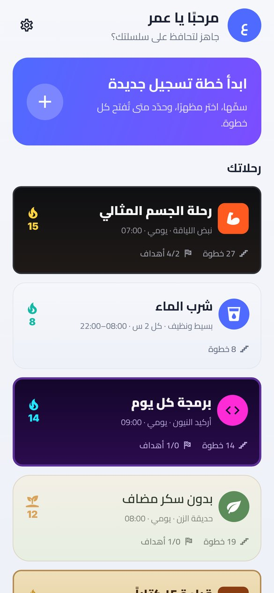<br><sub><b>الرئيسية</b>: كل رحلة بمظهرها الخاص</sub></td>
    <td align="center">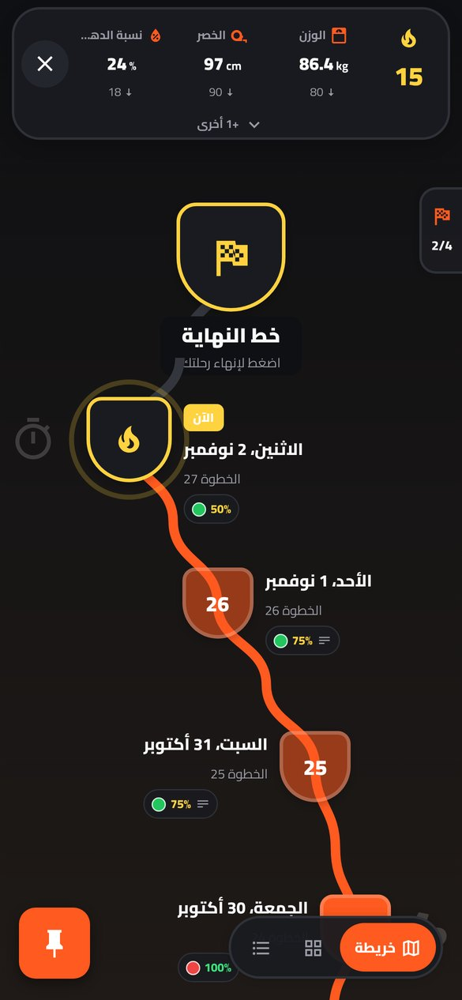<br><sub><b>خريطة الرحلة</b>: السلسلة والحالات والخطوات</sub></td>
    <td align="center">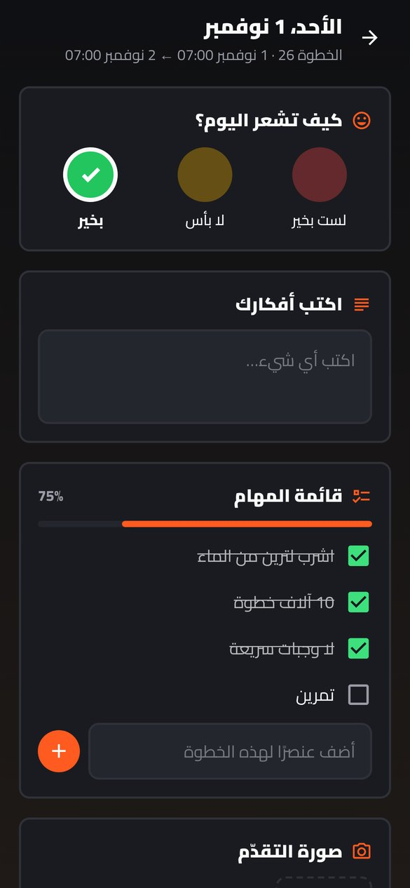<br><sub><b>الخطوة</b>: تُملأ من قالبك</sub></td>
  </tr>
  <tr>
    <td align="center">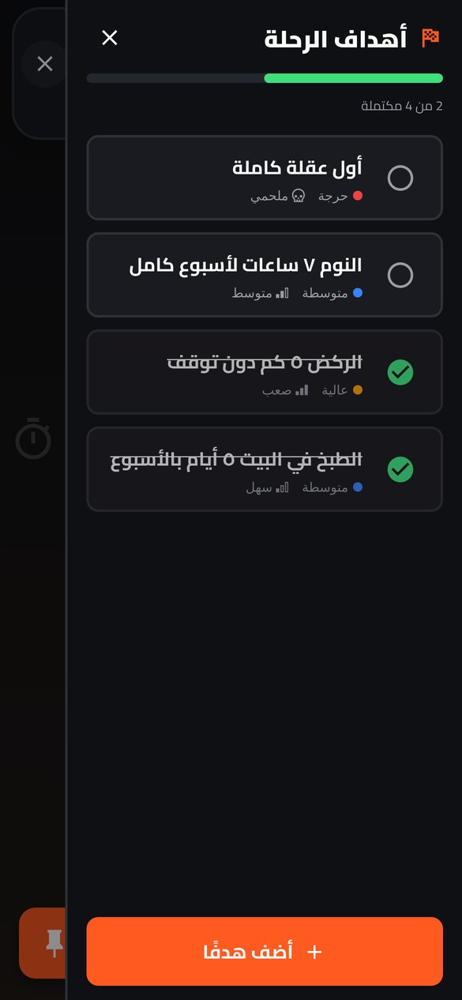<br><sub><b>الأهداف</b>: أولوية وصعوبة</sub></td>
    <td align="center">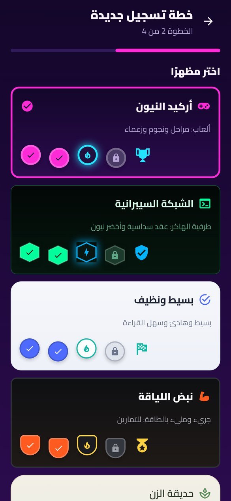<br><sub><b>خطة جديدة</b>: اختر أحد ٦ مظاهر</sub></td>
    <td align="center">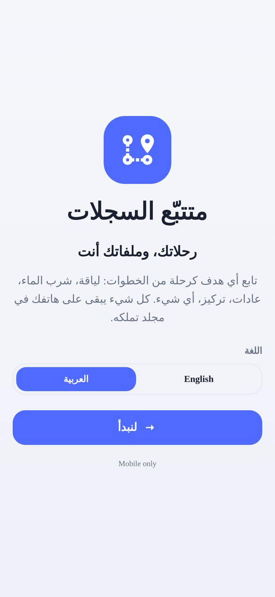<br><sub><b>البداية</b>: اختر اللغة والمجلد</sub></td>
  </tr>
</table>

<div dir="rtl">

### ستة مظاهر

كل مظهر يغيّر الألوان، وشكل العُقد، وشكل المسار، والأيقونات، والخطوط.

</div>

<table>
  <tr>
    <td align="center">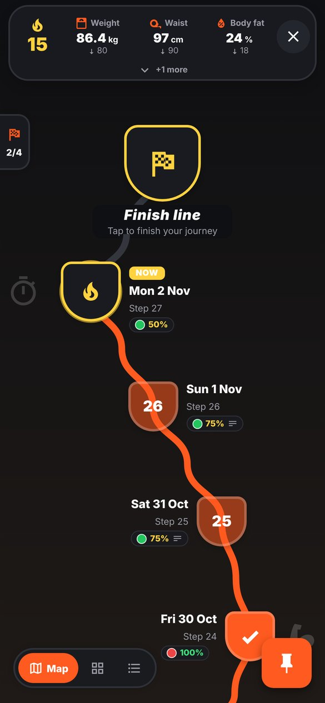<br><sub>نبض اللياقة</sub></td>
    <td align="center">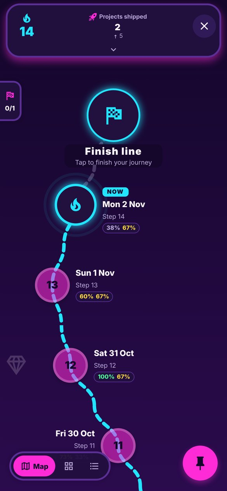<br><sub>أركيد النيون</sub></td>
    <td align="center">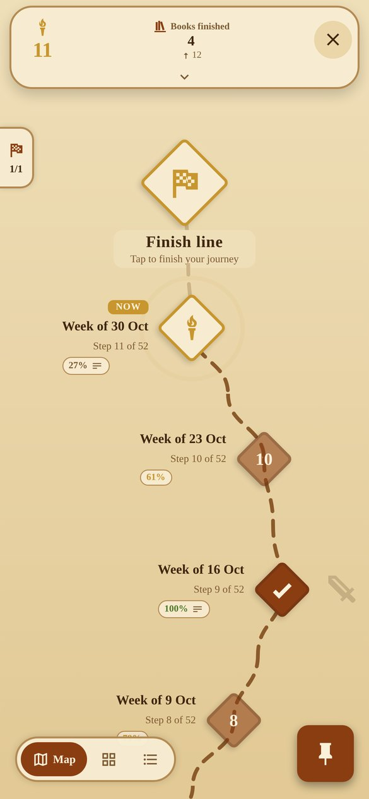<br><sub>خريطة المغامرة</sub></td>
    <td align="center">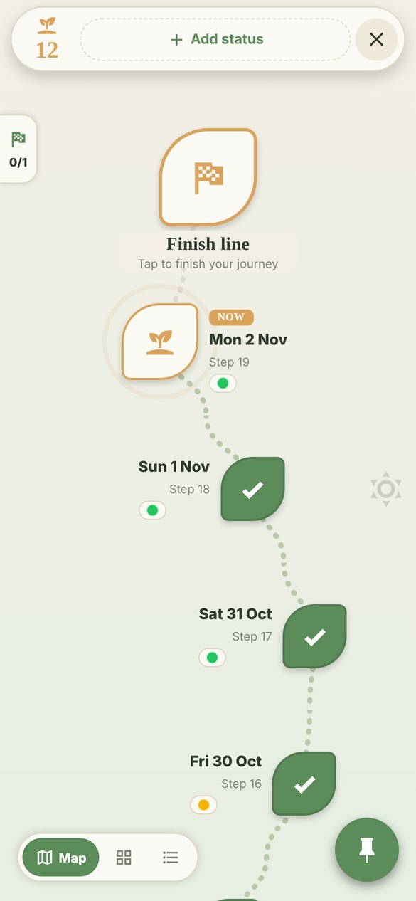<br><sub>حديقة الزن</sub></td>
    <td align="center">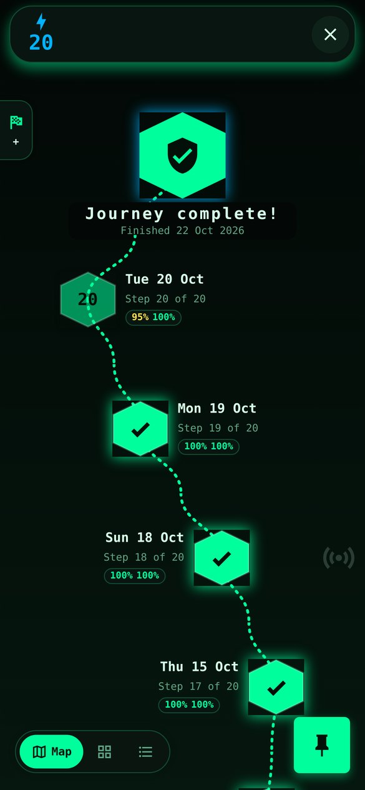<br><sub>الشبكة السيبرانية</sub></td>
    <td align="center">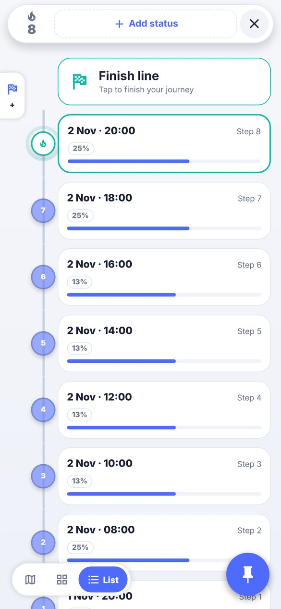<br><sub>بسيط ونظيف</sub></td>
  </tr>
</table>

<div dir="rtl">

## المزايا

| | |
|---|---|
| 🗺️ **ثلاث طرق لعرض الرحلة** | **خريطة** بأسلوب الألعاب، و**بطاقات**، و**قائمة** زمنية. يُحفظ اختيارك لكل خطة. |
| ⏰ **مواعيد مرنة للخطوات** | يومي، أو أسبوعي، أو شهري، أو سنوي، أو مخصص: كل N ساعات ضمن فترة، أو أوقات محددة يوميًا، أو أيام أسبوع تختارها، أو كل N أيام، أو يدوي. |
| 🏁 **نهاية الرحلة** | مفتوحة، أو بعد عدد من الخطوات (مثل تحدي ٣٠ يومًا)، أو في تاريخ محدد. |
| 🧩 **قوالب الخطوات** | ألوان المزاج، ونص، وقوائم مهام (مع بنود إضافية لخطوة واحدة)، وأرقام لها أهداف، ونعم/لا، وصور. فيه ٦ قوالب جاهزة، ويمكنك تعديل القالب في أي وقت دون أن تتغير الخطوات السابقة. |
| 🔥 **سلسلة الأيام** | تَعُدّ الخطوات التي ملأتها متتالية. تكبر السلسلة ويتغير لونها عند ١٠ و٣٠ و٩٠ و١٥٠ و٣٠٠ و٥٠٠. |
| 📊 **الحالات** | حتى ٧ قيم حية، مثل الوزن أو محيط الخصر أو المدخرات. لكل حالة هدف واتجاه (*أقل* أو *أعلى* أو *مطابق*)، وسجل كامل، ويمكن وضع علامة لكل تحديث على الخريطة. |
| 🏆 **أهداف الرحلة** | لكل هدف أولوية وصعوبة. عند إنجاز هدف يمكن أن يظهر كأس على الخريطة. |
| 📎 **ملاحظات ومرفقات** | أضف ملاحظات وصورًا وفيديوهات وملفات لأي خطة. تُنسخ المرفقات إلى مجلد الخطة نفسه. |
| 🔔 **تذكيرات محلية** | تذكير عند فتح خطوة جديدة، وتذكير يومي اختياري. لا يوجد خادم إشعارات. |
| 🌍 **عربي وإنجليزي** | انعكاس كامل للواجهة من اليمين إلى اليسار، وخط Cairo، ونصوص مختلطة تظهر بترتيبها الصحيح، وتبديل فوري. |
| 🔒 **الخصوصية أولًا** | لا حساب، ولا إحصاءات، ولا اتصال بالإنترنت. تصنيف الخصوصية في المتاجر: *لا تُجمع بيانات*. |

👈 الشرح الكامل شاشةً بشاشة في **[دليل المستخدم](docs/user-guide.ar.md)**.

## ماذا يمكنك أن تتابع؟

| المثال | المظهر | الموعد | ماذا تحتوي كل خطوة |
|---|---|---|---|
| إنقاص الوزن | نبض اللياقة | يومي | المزاج، والأفكار، وقائمة مهام (ماء، ١٠ آلاف خطوة، بلا وجبات سريعة، تمرين)، وصورة التقدم |
| شرب الماء | بسيط ونظيف | كل ساعتين، ٠٨:٠٠–٢٢:٠٠ | عدد الأكواب (الهدف ٨)، و«وصلت هدفي» نعم/لا |
| ترك عادة | حديقة الزن | يومي | «هل التزمت؟»، والمزاج، وما الذي سهّل الأمر أو صعّبه |
| الدراسة والعمل العميق | الشبكة السيبرانية | أيام أسبوع تختارها | دقائق التركيز (الهدف ١٢٠)، والمهام، وماذا تعلمت |
| القراءة | خريطة المغامرة | أسبوعي | الصفحات المقروءة (الهدف ١٥٠)، واقتباس مفضل |
| الدواء | بسيط ونظيف | ٠٨:٠٠ و١٤:٠٠ و٢٠:٠٠ | «أخذته؟» نعم/لا |

## بياناتك في مجلدك

</div>

```
record-tracker/
├── me.json                 اسمك وتفاصيلك
├── me.backup.json
└── <اسم الخطة>/
    ├── plan.json           المواعيد والقالب والخطوات والحالات والأهداف والعلامات
    ├── plan.backup.json
    └── attachments/        الصور والفيديوهات والملفات التي أضفتها
```

<div dir="rtl">

- **أندرويد:** تختار مجلدًا من منتقي المجلدات في النظام، والتطبيق لا يطلب أبدًا الوصول إلى كل ملفاتك.
- **iOS:** المجلد موجود في *الملفات › على الـ iPhone › Records Tracker*.
- **الاستعادة:** اختر المجلد القديم عند أول تشغيل، وسيرحب بك التطبيق بعبارة «أهلًا بعودتك».
- **حفظ آمن من الأعطال:** كل عملية حفظ تكتب نسخة `.backup.json` أولًا، ثم الملف الرئيسي.

> [!WARNING]
> في iOS، حذف التطبيق يحذف مجلده. انسخ مجلد `record-tracker` إلى مكان آمن قبل الحذف.

## تشغيل التطبيق

لا توجد نسخة على المتاجر بعد. لبناء التطبيق بنفسك:

</div>

```bash
git clone https://github.com/ASSOLI99/records-tracker.git
```

```bash
cd records-tracker && npm install --legacy-peer-deps
```

```bash
npx expo run:android
```

<div dir="rtl">

وعلى جهاز Mac استخدم `npx expo run:ios`. يحتاج التطبيق إلى **نسخة تطوير** (development build)
وليس Expo Go، لأنه يستخدم منتقي المجلدات والإشعارات وخطًا مضمّنًا. طريقة بناء ملف APK مستقل موجودة في
[ملاحظات التطوير](docs/development.ar.md).

## التقنيات المستخدمة

| المجال | الاختيار |
|---|---|
| إطار العمل | [Expo SDK 58](https://docs.expo.dev/)، و React Native 0.88، و React 19 |
| اللغة | TypeScript (الوضع الصارم) |
| التنقل | Expo Router (مبني على الملفات، `src/app/`) |
| التخزين | `expo-file-system`، مع Storage Access Framework في أندرويد ومجلد Documents في iOS |
| الوسائط | `expo-image-picker` و `expo-document-picker` و `expo-image` |
| التذكيرات | `expo-notifications` (محلية فقط) |
| الرسم | `react-native-svg` لمسار الرحلة وأشكال العُقد |
| الاختبارات | مشغّل الاختبارات المدمج في Node مع `tsx` |

## هيكل المشروع

</div>

```
src/
├── app/            الشاشات (Expo Router): البداية، الرئيسية، عني، خطة جديدة، الرحلة، الخطوة، التعديل
├── components/     منتقي المظهر، محررا المواعيد والقوالب، عروض الرحلة، جزيرة الحالات، الأهداف
├── model/          المنطق الصافي: الأنواع، فترات المواعيد، السلاسل، التقدم، القوالب (عليه اختبارات)
├── storage/        الوصول للمجلد (يدعم SAF) وحفظ الخطط والملف الشخصي والمرفقات
├── state/          حالة التطبيق: مرحلة الإعداد، المجلد، الملف الشخصي، الخطط، اللغة
├── i18n/           نصوص العربية والإنجليزية، عزل الاتجاه، التواريخ
├── themes/         المظاهر الستة وكتالوج الأيقونات
└── ui/             مكونات الواجهة، المظاهر، خطاف الاتجاه، النوافذ والحوارات
```

<div dir="rtl">

قرارات التصميم وملاحظات البناء في **[ملاحظات التطوير](docs/development.ar.md)**.

## الفحوصات

</div>

```bash
npm run typecheck
```

```bash
npm run lint
```

```bash
npm test
```

<div dir="rtl">

تعمل الفحوصات الثلاثة تلقائيًا في CI مع كل push و pull request.

## خارطة الطريق

- [ ] النشر على App Store و Google Play (مفتاح الرفع، وملف `.aab`، وصفحة المتجر)
- [ ] ودجت للشاشة الرئيسية يعرض خطوة اليوم والسلسلة (`expo-widgets`)
- [ ] رسوم بيانية لسجل الحالات، وخريطة حرارية تقويمية للخطوات المملوءة
- [ ] تصدير النسخة الاحتياطية بضغطة واحدة (ملف zip يُشارك إلى Drive أو iCloud)
- [ ] وضع داكن لشاشات التطبيق نفسه (الرئيسية والإعدادات والمعالج)
- [ ] اهتزاز خفيف عند إكمال خطوة أو هدف

الأفكار وتقارير الأخطاء مرحب بها. [افتح issue](https://github.com/ASSOLI99/records-tracker/issues).

## المساهمة

نرحب بطلبات الدمج (pull requests). اقرأ **[دليل المساهمة](CONTRIBUTING.md)** أولًا. باختصار: كل نص
يظهر للمستخدم يحتاج نسخة عربية وأخرى إنجليزية، وكل تخطيط يجب أن يعمل من اليمين إلى اليسار، ويجب أن تنجح
فحوصات `typecheck` و `lint` و `test`.

## شكر وتقدير

- خط [Cairo](https://fonts.google.com/specimen/Cairo) © The Cairo Project Authors، مرخّص بموجب
  SIL Open Font License 1.1 ([`assets/fonts/Cairo-OFL.txt`](assets/fonts/Cairo-OFL.txt)).
- الأيقونات من [Material Design Icons](https://pictogrammers.com/library/mdi/) عبر `@expo/vector-icons`.

</div>

---

<div align="center">
صنعه <a href="https://github.com/ASSOLI99">Abdullah Assoli</a> · Assoli Industries
</div>
