<div align="center">


# Records Tracker

**Turn any goal into a journey of steps, stored in files you own.**

**English** · [العربية](README.ar.md)

[](https://github.com/ASSOLI99/records-tracker/actions/workflows/ci.yml)


[](https://github.com/ASSOLI99/records-tracker/releases/latest)
[](LICENSE)

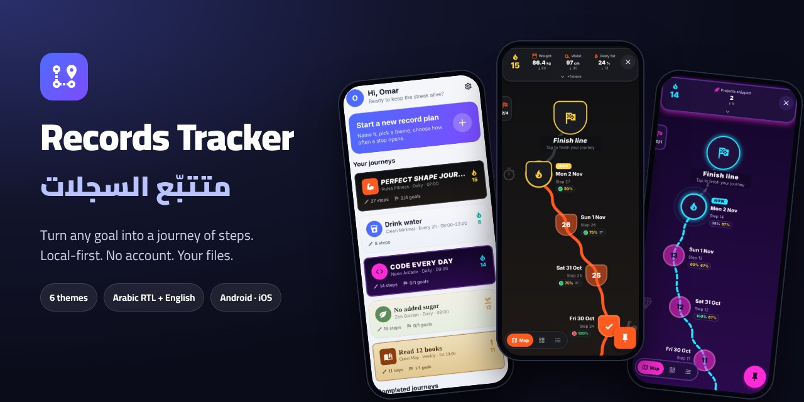

</div>

---

## The idea

Most habit trackers give you a checkbox and a calendar. Records Tracker gives every goal its own
**journey**, a path that grows one step at a time, the way a level map grows in a game.

- You decide **when a new step opens**: every day, every 2 hours, on gym days, or only when you add one.
- You decide **what goes into each step**: mood, notes, a to-do list, numbers with targets, yes/no, photos.
- You watch the path grow, keep a **streak** alive, track **statuses** such as weight or savings
  against a target, and tick off the **goals** of the journey.

It is **local-first**: no account, no server, no tracking. Everything is saved as plain JSON files
in one `record-tracker` folder on your phone. To back it up, copy the folder to Google Drive,
iCloud or a computer.

It is **bilingual**: English and Arabic, with a full right-to-left layout, the Cairo typeface for
Arabic, and live switching with no restart.

## Screenshots

<table>
  <tr>
    <td align="center">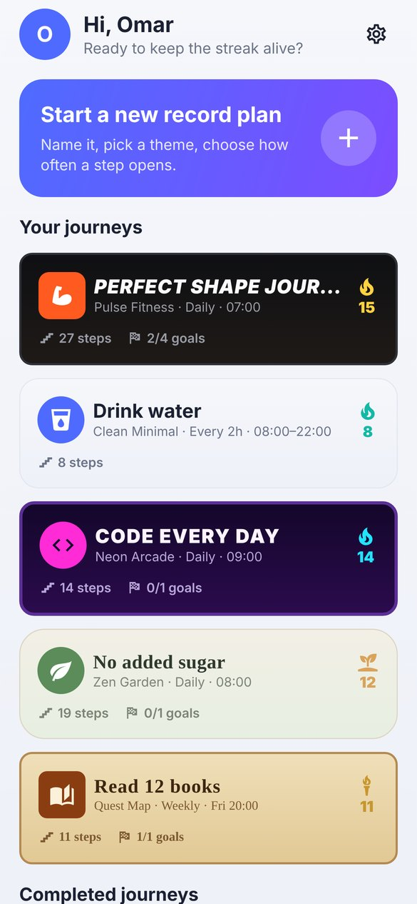<br><sub><b>Home</b>: every journey in its own theme</sub></td>
    <td align="center">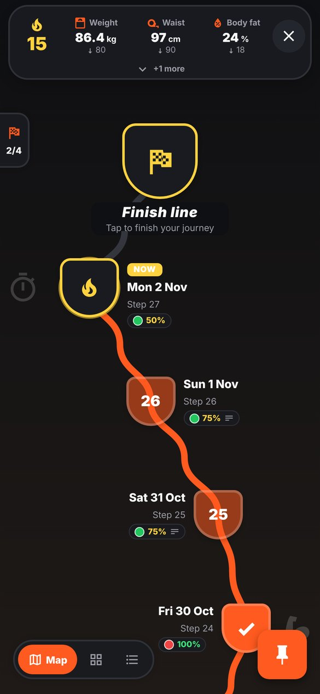<br><sub><b>Journey map</b>: streak, statuses, steps</sub></td>
    <td align="center">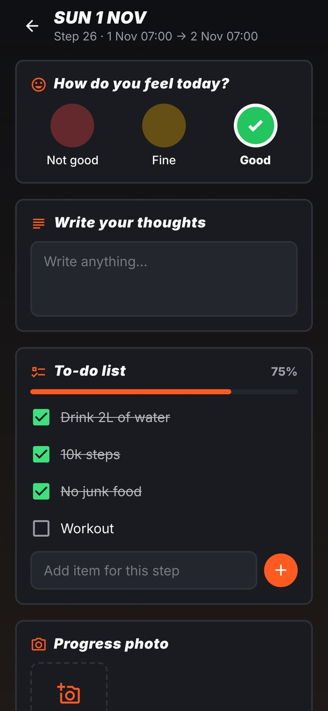<br><sub><b>A step</b>: filled from your template</sub></td>
  </tr>
  <tr>
    <td align="center">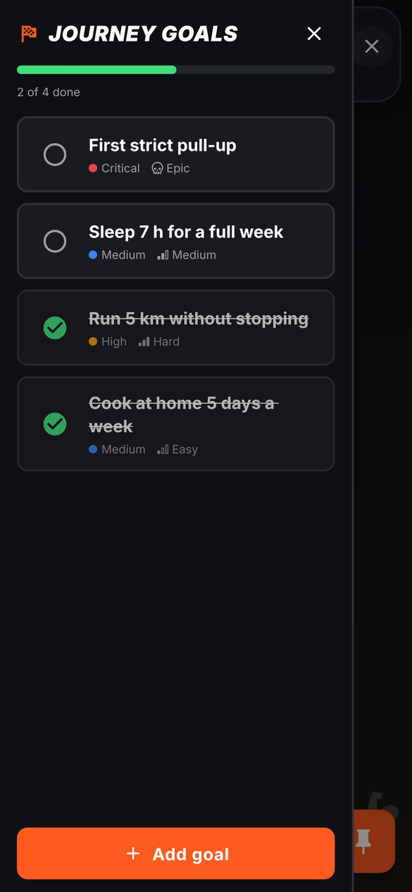<br><sub><b>Goals</b>: priority and difficulty</sub></td>
    <td align="center">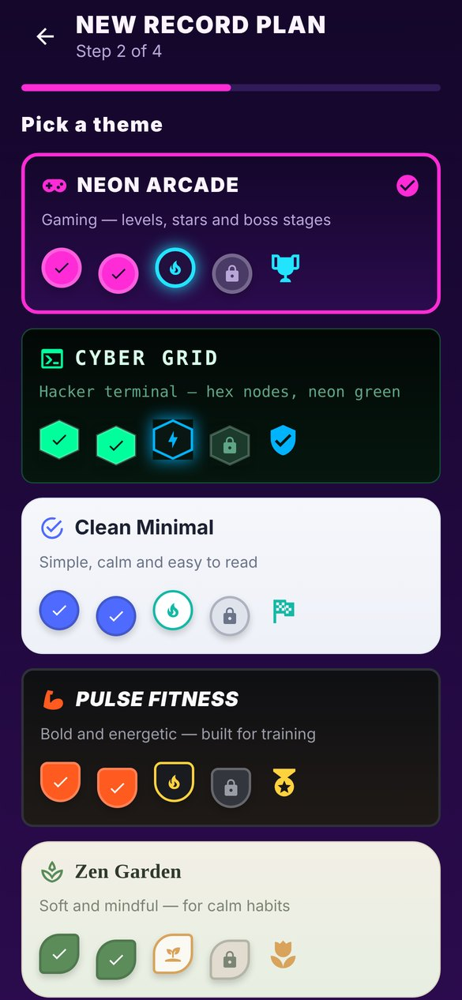<br><sub><b>New plan</b>: pick one of 6 themes</sub></td>
    <td align="center">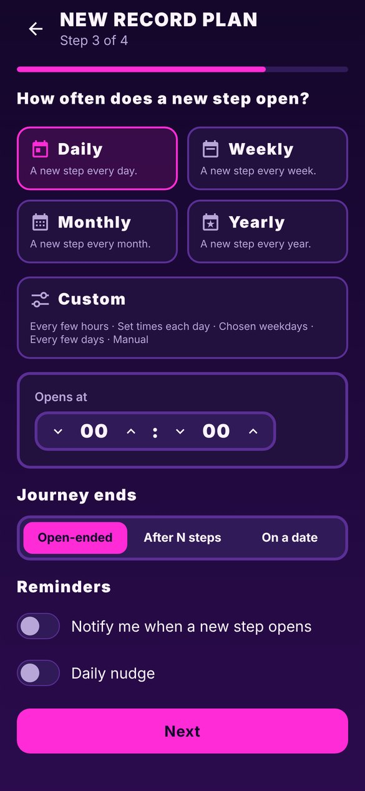<br><sub><b>Triggers</b>: when a step opens</sub></td>
  </tr>
</table>

### In Arabic (RTL)

<table>
  <tr>
    <td align="center">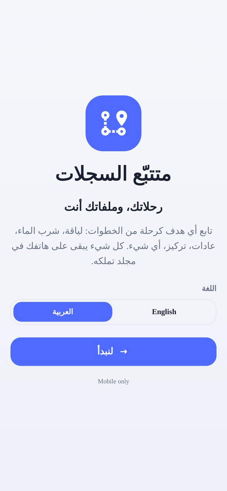</td>
    <td align="center">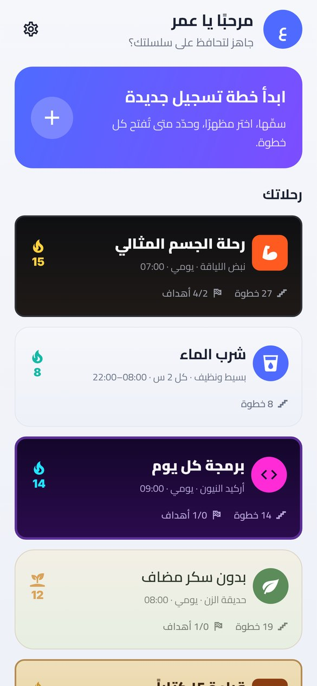</td>
    <td align="center">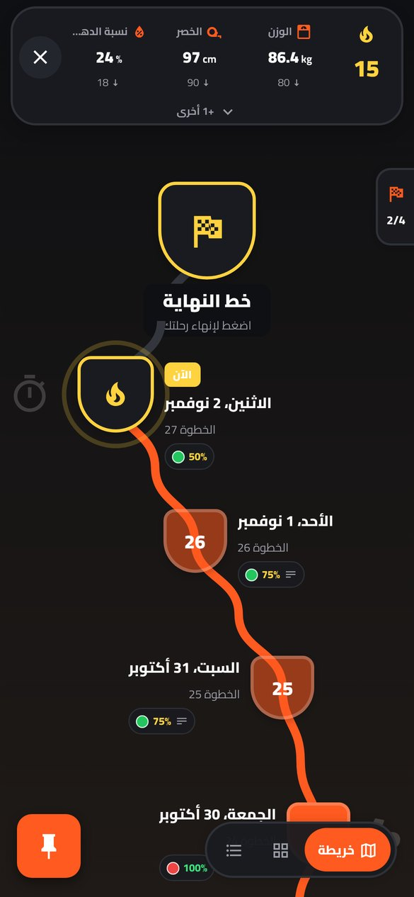</td>
  </tr>
</table>

### Six themes

Each theme changes colours, node shapes, path style, icons and fonts.

<table>
  <tr>
    <td align="center"><br><sub>Pulse Fitness</sub></td>
    <td align="center">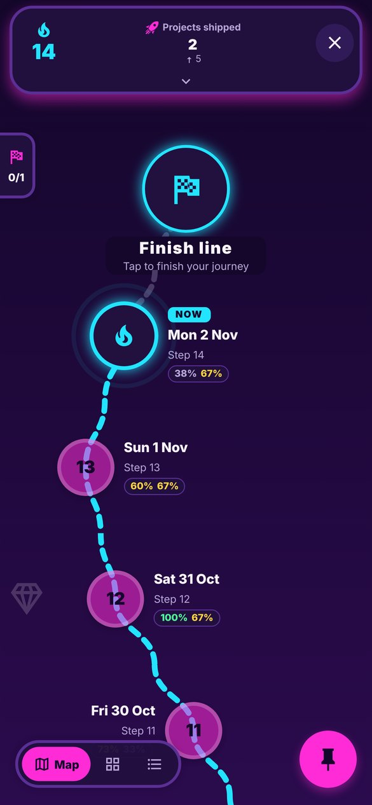<br><sub>Neon Arcade</sub></td>
    <td align="center">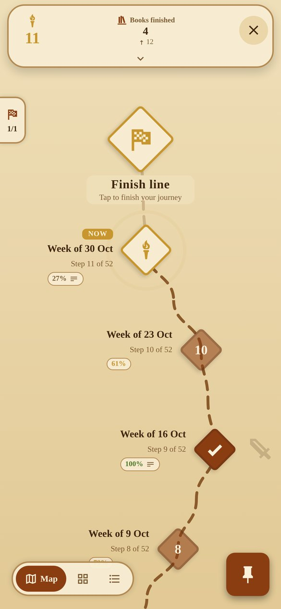<br><sub>Quest Map</sub></td>
    <td align="center">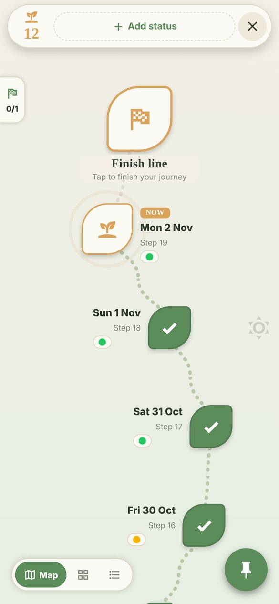<br><sub>Zen Garden</sub></td>
    <td align="center">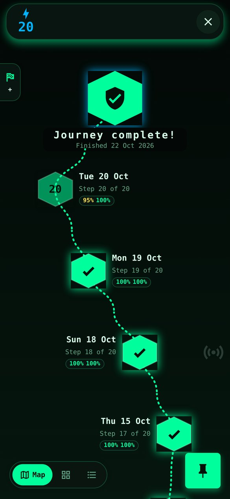<br><sub>Cyber Grid</sub></td>
    <td align="center">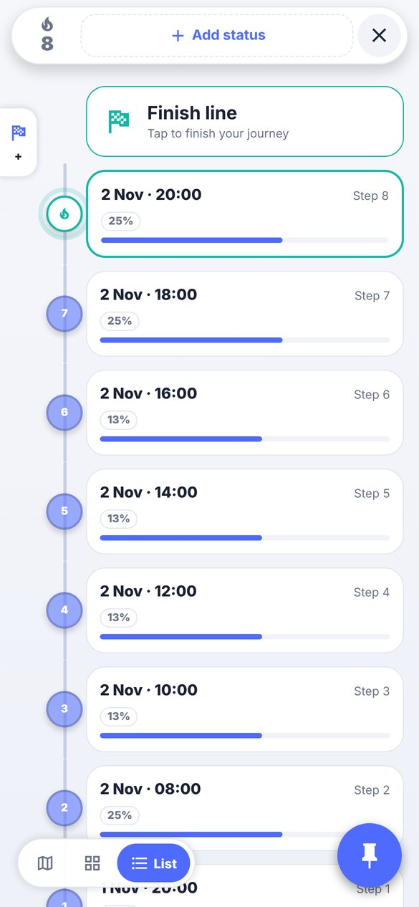<br><sub>Clean Minimal</sub></td>
  </tr>
</table>

## Features

| | |
|---|---|
| 🗺️ **Three journey views** | A game-style **map**, a **cards** grid and a **list** timeline. The choice is saved per plan. |
| ⏰ **Flexible triggers** | Daily, weekly, monthly or yearly, or custom: every N hours in a window, set times each day, chosen weekdays, every N days, or manual. |
| 🏁 **End rules** | Open-ended, after N steps (a 30-day challenge, for example), or on a date. |
| 🧩 **Step templates** | Mood colours, text, to-do lists (plus extra items for a single step), numbers with targets, yes/no and photos. There are 6 starter templates, and you can edit a template at any time without changing past steps. |
| 🔥 **Streaks** | Count the steps you filled in a row. The streak grows and changes colour at 10, 30, 90, 150, 300 and 500. |
| 📊 **Statuses** | Up to 7 live values, such as weight, waist or savings. Each has a target and a direction (*lower*, *higher* or *matches*), a full history, and optional markers on the map. |
| 🏆 **Journey goals** | Each goal has a priority and a difficulty. When you complete one, a trophy can appear on the map. |
| 📎 **Notes and attachments** | Add notes, photos, videos and files to any step. Attachments are copied into the plan's own folder. |
| 💾 **One-tap backup** | Export everything (plans, steps, notes, photos, videos) as one `.zip`, then save it to Drive, iCloud or anywhere. Restore it from the same screen, or on a new phone during setup. |
| 📱 **Home-screen widget** | On Android, a widget shows your active journeys, their streaks and whether today's step is done. |
| 🔔 **Local reminders** | You can be reminded when a new step opens, and get an optional daily nudge. No push server is involved. |
| 🌍 **Arabic and English** | Full RTL mirroring, the Cairo font, bidi-safe mixed text, and live switching. |
| 🔒 **Private by design** | No account, no analytics and no network calls. Store privacy label: *Data Not Collected*. |

👉 For the screen-by-screen guide, see **[docs/user-guide.md](docs/user-guide.md)**.

## What you can track

| Example | Theme | Trigger | What each step holds |
|---|---|---|---|
| Losing weight | Pulse Fitness | Daily | Mood, thoughts, a to-do list (water, 10k steps, no junk food, workout), a progress photo |
| Drinking water | Clean Minimal | Every 2 h, 08:00–22:00 | Glasses of water (target 8), a "reached my goal" yes/no |
| Quitting a habit | Zen Garden | Daily | "Did I keep it?", mood, what made it easy or hard |
| Studying or deep work | Cyber Grid | Chosen weekdays | Focused minutes (target 120), tasks, what I learned |
| Reading | Quest Map | Weekly | Pages read (target 150), a favourite quote |
| Medicine | Clean Minimal | 08:00, 14:00, 20:00 | "Took it?" yes/no |

## Your data, your folder

```
record-tracker/
├── me.json                 your name and details
├── me.backup.json
└── <Plan name>/
    ├── plan.json           triggers, template, steps, statuses, goals, markers
    ├── plan.backup.json
    └── attachments/        photos, videos and files you added
```

- **Android:** you pick a folder with the system folder picker. The app never asks for access to
  all your files.
- **iOS:** the folder is at *Files › On My iPhone › Records Tracker*.
- **Backup in one tap:** *About me › Backup & restore › Export backup (.zip)* puts the whole folder
  in a single file and opens the share sheet.
- **Restore:** use *Restore from a backup file*, or pick the old folder on first launch. The app
  greets you with "Welcome back".
- **Crash-safe saves:** each save writes a `.backup.json` first and then the main file.

> [!WARNING]
> On iOS, deleting the app deletes its folder. Copy `record-tracker` somewhere safe first.

## Get the app

### Android: download the APK

1. Open the **[latest release](https://github.com/ASSOLI99/records-tracker/releases/latest)** and
   download `records-tracker-<version>.apk`.
2. Open the file on your phone and allow installing from that source if Android asks.
3. To update, install the newer APK over the old one. Your data stays in your `record-tracker` folder.

Requires Android 7.0 or later. To add the widget, long-press your home screen, tap **Widgets**, and
choose **Records Tracker**.

### Build it yourself

```bash
git clone https://github.com/ASSOLI99/records-tracker.git
```

```bash
cd records-tracker && npm install --legacy-peer-deps
```

```bash
npx expo run:android
```

On a Mac, run `npx expo run:ios` instead. The app needs a **development build**, not Expo Go,
because it uses the folder picker, notifications, the widget and a bundled font. How releases are
built is described in [docs/development.md](docs/development.md).

## Tech stack

| Area | Choice |
|---|---|
| Framework | [Expo SDK 58](https://docs.expo.dev/), React Native 0.88, React 19 |
| Language | TypeScript (strict) |
| Navigation | Expo Router (file-based, `src/app/`) |
| Storage | `expo-file-system`, using the Storage Access Framework on Android and Documents on iOS |
| Media | `expo-image-picker`, `expo-document-picker`, `expo-image` |
| Reminders | `expo-notifications` (local only) |
| Drawing | `react-native-svg` for the journey path and node shapes |
| Tests | Node's built-in test runner with `tsx` |

## Project structure

```
src/
├── app/            screens (Expo Router): onboarding, home, about me, new plan, journey, step, edit
├── components/     theme picker, trigger and template editors, journey views, status island, goals
├── model/          pure logic: types, trigger periods, streaks, progress, presets (unit-tested)
├── storage/        folder access (SAF-aware) and plan, profile and attachment persistence
├── state/          app state: setup phase, root folder, profile, plans, language
├── i18n/           English and Arabic strings, bidi isolation, dates
├── themes/         the 6 themes and the icon catalogue
└── ui/             UI kit, theming, direction hook, sheets and dialogs
```

Design decisions and build notes are in **[docs/development.md](docs/development.md)**.

## Development

```bash
npm run typecheck
```

```bash
npm run lint
```

```bash
npm test
```

All three also run in CI on every push and pull request.

## Roadmap

- [ ] App Store and Google Play releases (upload key, `.aab`, store listing)
- [x] Home-screen widget on Android with streaks and today's step
- [ ] The same widget on iOS (needs a SwiftUI layout and an App Group)
- [ ] Charts for status history, plus a calendar heat-map of filled steps
- [x] One-tap backup export and restore (`.zip`)
- [x] Downloadable APK on every release
- [ ] Dark mode for the app's own screens (home, settings, wizard)
- [ ] Haptic feedback when you complete a step or a goal

Ideas and bug reports are welcome. Please [open an issue](https://github.com/ASSOLI99/records-tracker/issues).

## Contributing

Pull requests are welcome. Read **[CONTRIBUTING.md](CONTRIBUTING.md)** first. In short: every
user-facing string needs both an English and an Arabic version, every layout must work in RTL,
and `typecheck`, `lint` and `test` must pass.

## License

Records Tracker is released under the **[MIT License](LICENSE)**. You may use, change and
share it, including commercially, as long as the copyright notice stays with it.

## Credits

- The [Cairo](https://fonts.google.com/specimen/Cairo) typeface is © The Cairo Project Authors,
  licensed under the SIL Open Font License 1.1 ([`assets/fonts/Cairo-OFL.txt`](assets/fonts/Cairo-OFL.txt)).
- Icons are from [Material Design Icons](https://pictogrammers.com/library/mdi/), through `@expo/vector-icons`.

---

<div align="center">
Made by <a href="https://github.com/ASSOLI99">Abdullah Assoli</a> · Assoli Industries
</div>
