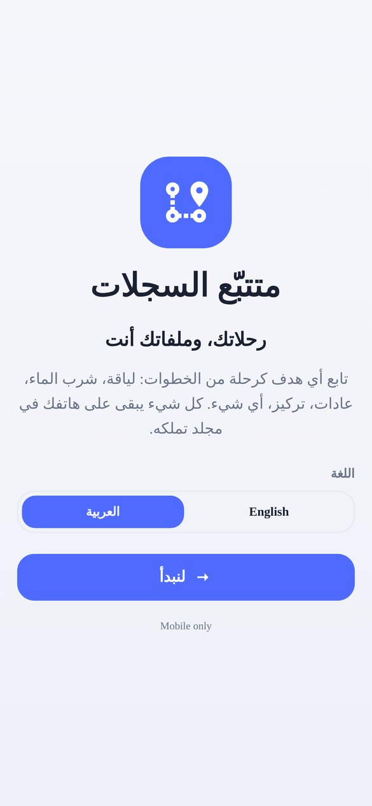
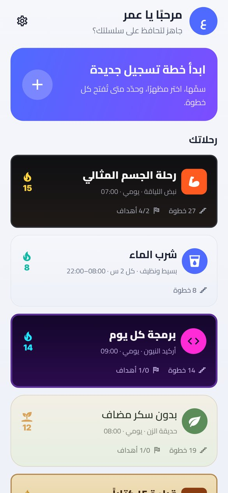
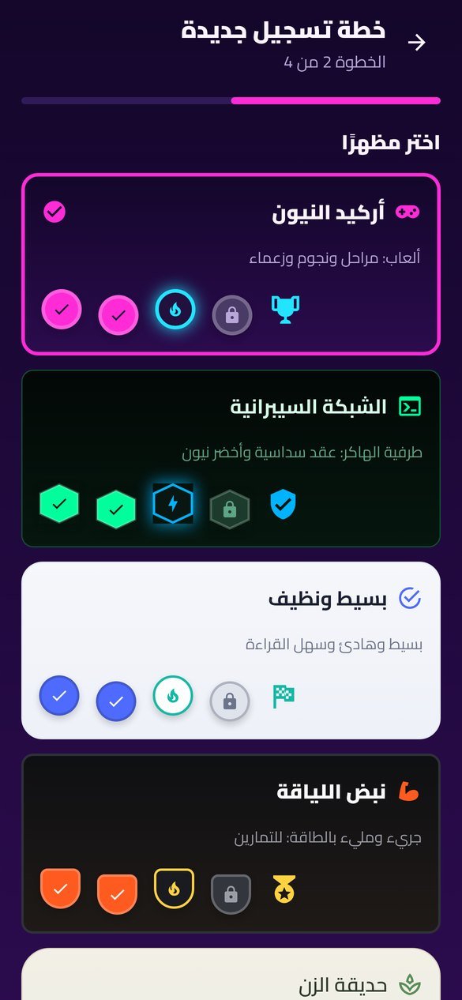
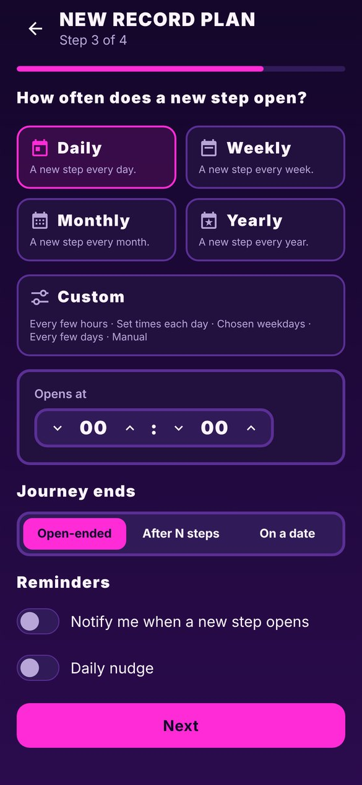
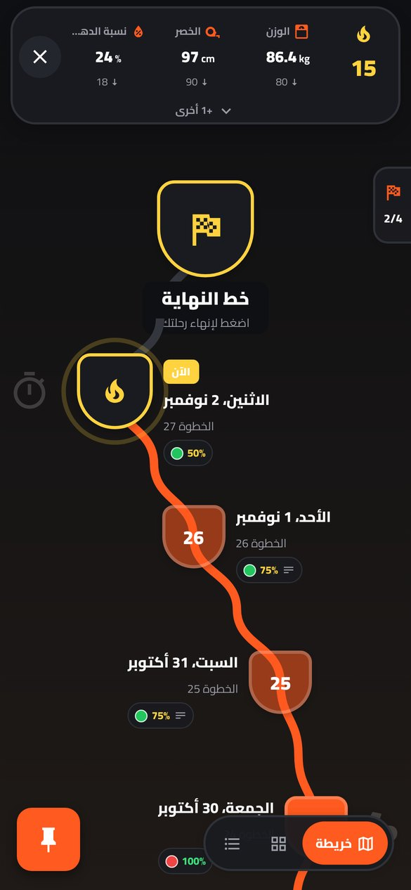
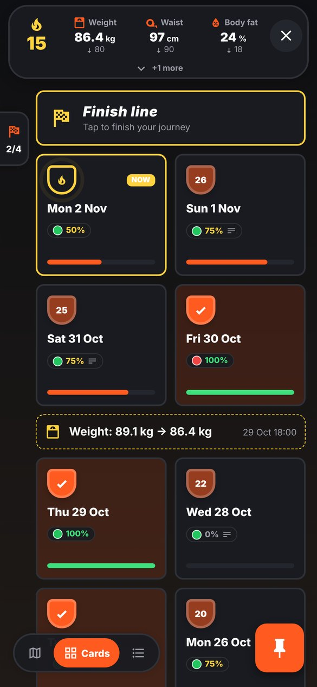
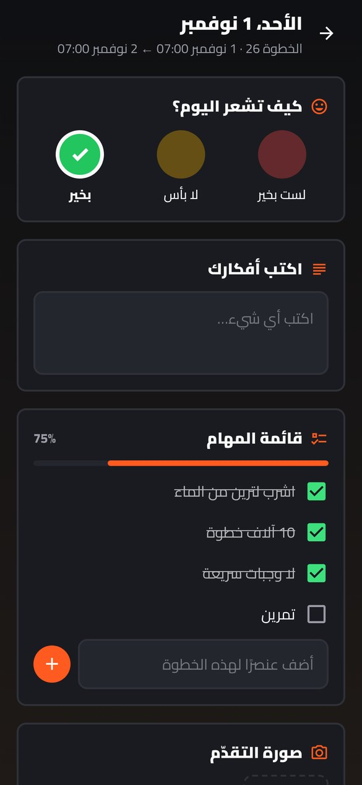
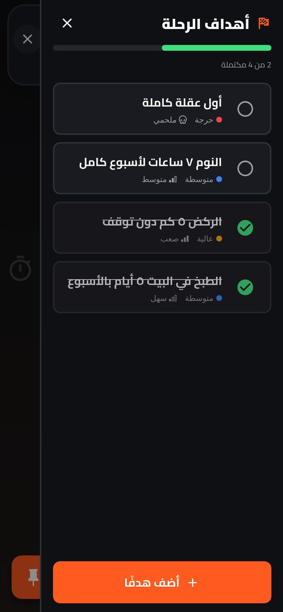

<div dir="rtl">

# متتبّع السجلات: دليل المستخدم

[English](user-guide.md) · **العربية** · [→ العودة إلى الصفحة الرئيسية](../README.ar.md)

كل ما يستطيع التطبيق فعله، شاشةً بشاشة.

## المحتويات

- [١. أول تشغيل](#١-أول-تشغيل)
- [٢. الرئيسية](#٢-الرئيسية)
- [٣. إنشاء خطة تسجيل](#٣-إنشاء-خطة-تسجيل)
- [٤. شاشة الرحلة](#٤-شاشة-الرحلة)
- [٥. ملء الخطوة](#٥-ملء-الخطوة)
- [٦. الحالات](#٦-الحالات)
- [٧. أهداف الرحلة](#٧-أهداف-الرحلة)
- [٨. تعديل الخطة لاحقًا](#٨-تعديل-الخطة-لاحقًا)
- [٩. إنهاء الرحلة](#٩-إنهاء-الرحلة)
- [١٠. اللغة واتجاه الواجهة](#١٠-اللغة-واتجاه-الواجهة)
- [١١. النسخ الاحتياطي والاستعادة](#١١-النسخ-الاحتياطي-والاستعادة)
- [١٢. التذكيرات](#١٢-التذكيرات)
- [١٣. ملف النسخة الاحتياطية (zip)](#١٣-ملف-النسخة-الاحتياطية-zip)
- [١٤. ودجت الشاشة الرئيسية (أندرويد)](#١٤-ودجت-الشاشة-الرئيسية-أندرويد)

## ١. أول تشغيل

<p align="center"></p>

1. **اختر اللغة:** English أو العربية. يمكنك تغييرها لاحقًا من الإعدادات، وتنعكس الواجهة فورًا.
2. **اختر مكان حفظ بياناتك.**
   - **أندرويد:** اضغط **اختر مجلدًا** واختر مجلدًا مثل *Documents*. سينشئ التطبيق داخله مجلد
     `record-tracker`. يصل التطبيق إلى هذا المجلد فقط، ولا يطلب أبدًا الوصول إلى كل ملفاتك.
   - **iOS:** لا تحتاج إلى اختيار شيء. تُحفظ بياناتك في *الملفات › على iPhone › Records Tracker ›
     record-tracker*.
   - **تستعيد بياناتك؟** في أندرويد اختر المجلد الذي *يحتوي* مجلد `record-tracker` القديم، أو مجلد
     `record-tracker` نفسه، وسيعرض التطبيق «أهلًا بعودتك» ويحمّل كل شيء. وفي iOS انسخ المجلد إلى
     *الملفات › على iPhone › Records Tracker* ثم اضغط **تحقق مجددًا**.
3. **اكتب اسمك** (مطلوب).
4. **أخبرنا المزيد (اختياري).** أضف أي عدد من المعلومات عنك: تسمّي الحقل وتكتب قيمته، مثل الطول
   أو تاريخ الميلاد أو الوزن المستهدف أو رياضتك المفضلة. اضغط **تخطَّ الآن** لتضيفها لاحقًا من **عنّي**.

## ٢. الرئيسية

<p align="center"></p>

- **مرحبًا يا *اسمك*.** اضغط صورتك الرمزية أو أيقونة الترس لتفتح **عنّي / الإعدادات** (معلوماتك،
  واللغة، ومجلد البيانات، وشرح النسخ الاحتياطي).
- **ابدأ خطة تسجيل جديدة.** الزر الكبير في الأعلى.
- **رحلاتك.** بطاقة لكل خطة نشطة، مرسومة بمظهر تلك الخطة. تعرض المحفّز، والسلسلة الحالية 🔥،
  وعدد الخطوات، وكم هدفًا أنجزت.
- **رحلات مكتملة.** الخطط التي أنهيتها، مع تاريخ الإنهاء.
- في الأسفل: مكان حفظ بياناتك.

## ٣. إنشاء خطة تسجيل

<p align="center"> </p>

معالج من أربع خطوات:

1. **سمِّ الخطة**، واختر **أيقونة** إن أردت من نحو ٧٤٠٠ أيقونة قابلة للبحث (البحث يعمل بالإنجليزية
   وبكلمات عربية شائعة مثل ماء ووزن ورياضة).
2. **اختر مظهرًا.** لكل مظهر ألوانه وشكل عُقده وشكل مساره وخطوطه:

   | المظهر | الأسلوب |
   |---|---|
   | **أركيد النيون** | ألعاب: وردي وسماوي نيون، عُقد مراحل دائرية، نجوم، وكأس في النهاية |
   | **الشبكة السيبرانية** | طرفية الهاكر: أخضر نيون، خط أحادي العرض، عُقد سداسية |
   | **بسيط ونظيف** | بسيط وهادئ: أبيض وأزرق، سهل القراءة، والقائمة هي العرض الافتراضي |
   | **نبض اللياقة** | جريء ومليء بالطاقة: برتقالي على رمادي فحمي، عُقد على شكل درع، وميدالية في النهاية |
   | **حديقة الزن** | ناعم وهادئ: أخضر مريمي ورملي، عُقد على شكل ورقة، ومسار منقّط |
   | **خريطة المغامرة** | مغامرة: ورق قديم، خط مذيّل، عُقد معيّنة، وصندوق كنز في النهاية |

3. **حدّد متى تُفتح خطوة جديدة.**

   | المحفّز | تُفتح خطوة جديدة… | مناسب لـ |
   |---|---|---|
   | يومي | كل يوم في الوقت الذي تحدده | معظم العادات |
   | أسبوعي | في يوم من الأسبوع وفي وقت محدد | المراجعات الأسبوعية |
   | شهري | في يوم من الشهر (الأيام ٢٩–٣١ تصبح آخر يوم في الشهر عند الحاجة) | الميزانية والفحوصات |
   | سنوي | في تاريخ كل سنة | الأهداف السنوية |
   | **مخصص: كل بضع ساعات** | كل N ساعات ضمن فترة، مثل كل ساعتين من ٠٨:٠٠ إلى ٢٢:٠٠ | شرب الماء |
   | **مخصص: أوقات محددة يوميًا** | في أوقات تكتبها، مثل ٠٨:٠٠ و١٤:٠٠ و٢٠:٠٠ | الدواء والوجبات |
   | **مخصص: أيام محددة** | في الأيام التي تختارها فقط، مثل الأحد والثلاثاء والخميس | أيام النادي |
   | **مخصص: كل بضعة أيام** | كل N أيام | سقاية النباتات والمراجعات |
   | **مخصص: يدوي** | فقط عندما تضغط **أضف خطوة** | المتابعة المرتبطة بالأحداث |

   وفي هذه الصفحة أيضًا:
   - **تنتهي الرحلة:** *مفتوحة*، أو *بعد عدد خطوات* (مثل تحدي ٣٠ يومًا)، أو *في تاريخ محدد*.
   - **التذكيرات:** *نبّهني عند فتح خطوة جديدة*، و*تذكير يومي* اختياري في وقت تختاره.

4. **ماذا ستملأ في كل خطوة؟** ابدأ من قالب: تسجيل المزاج، أو يوم لياقة، أو شرب الماء، أو متابعة
   عادة، أو تركيز ودراسة، أو فارغ. يمكنك تغييره متى شئت لاحقًا.

اضغط **أنشئ الخطة**. سيُنشأ مجلد باسم الخطة داخل `record-tracker`، وتنتقل مباشرة إلى الرحلة.

## ٤. شاشة الرحلة

<p align="center"> </p>

- **السلسلة** (في بداية الشريط العلوي). عدد الخطوات المتتالية التي ملأتها. تكبر ويتغير لونها عند
  **١٠ و٣٠ و٩٠ و١٥٠ و٣٠٠ و٥٠٠** (وتاج عند ٥٠٠). خطوة اليوم لا تكسر السلسلة قبل انتهاء وقتها. اضغطها
  لترى أفضل سلسلة لك والمحطة القادمة.
- **الحالات** (في الوسط). حتى **٧** أشياء تتابعها الآن (انظر [الحالات](#٦-الحالات)).
- **✕** (في نهاية الشريط). العودة إلى الرئيسية.
- **لسان الأهداف** (على حافة البداية). يفتح [درج الأهداف](#٧-أهداف-الرحلة).
- **الرحلة نفسها:**
  - **خريطة:** مسار متعرّج بأسلوب الألعاب، وأحدث خطوة في الأعلى تحت خط النهاية.
  - **بطاقات:** شبكة من بطاقات الخطوات.
  - **قائمة:** خط زمني.
  - بدّل بينها من الشريط في الأسفل، ويُحفظ اختيارك لكل خطة.
- **ما تعرضه الخطوة دون أن تفتحها:**
  - **نقطة ملونة** بلون المزاج الذي اخترته؛
  - **نسبة الإنجاز** لأول حقلين من نوع قائمة مهام أو رقم (و`…` إن كان هناك المزيد)؛
  - **أيقونة نص** إن كتبت شيئًا؛
  - **أيقونات صورة وفيديو وملف** إن أرفقت شيئًا.
- **حالات العُقدة:**
  - **الآن:** الخطوة المفتوحة حاليًا، وهي تنبض.
  - **مملوءة:** بلون المظهر.
  - **مكتملة:** علامة صح (ونجمة في أركيد النيون).
  - **فائتة:** باهتة.
- **علامات بين الخطوات:** تحديثات الحالات التي اخترت تسجيلها، والأهداف التي حققتها.
- **📌 الدبوس** (في نهاية الشريط السفلي). يفتح ثلاثة إجراءات: **تعديل المحفّزات** و**تعديل قالب الخطوة**
  و**تعديل الخطة**.
- **أضف خطوة:** يظهر بجانب مبدّل العرض عندما يكون المحفّز *يدويًا*.

## ٥. ملء الخطوة

<p align="center"></p>

اضغط أي خطوة لتفتحها. يُكتب عنوانها تلقائيًا حسب المحفّز: التاريخ للخطوات اليومية، و«أسبوع …»
للأسبوعية، والشهر للشهرية، والتاريخ والوقت للخطوات كل بضع ساعات.

| الحقل | طريقة عمله |
|---|---|
| **مزاج / لون** | اضغط أحد الخيارات (الافتراضي: أحمر *لست بخير*، أصفر *لا بأس*، أخضر *بخير*). اضغطه مرة أخرى لإلغائه. لونه يصبح نقطة الخطوة على الخريطة. |
| **نص** | اكتب بحرية. يُحفظ عندما تتوقف عن الكتابة أو تغادر الحقل. |
| **قائمة مهام** | علّم العناصر. أضف **عناصر إضافية لهذه الخطوة فقط** من الحقل في الأسفل (ليوم خاص مثلًا) دون أن يتغير القالب، واحذف العنصر الإضافي بـ ✕. الشريط يعرض نسبة الإنجاز. |
| **رقم** | استخدم − / + أو اكتب القيمة. إن كان للقالب هدف (مثل ٨ أكواب) سترى `6 / 8` وشريط تقدم. |
| **نعم / لا** | اضغط نعم أو لا، واضغط مرة أخرى لإلغاء الاختيار. |
| **صورة** | **أضف صورة** يتيح الكاميرا أو مكتبة الصور. |

وتحت حقول القالب:

- **الملاحظات.** أضف ما تشاء منها. اضغط الملاحظة لتعدلها أو تحذفها.
- **الملفات والوسائط.** أضف صورًا وفيديوهات من مكتبتك (عدة ملفات معًا)، أو التقط صورة، أو أرفق أي
  ملف. **تُنسخ إلى مجلد `attachments` الخاص بالخطة** فتبقى مع بياناتك. اضغط الصورة لتراها بملء
  الشاشة، واضغط الفيديو أو الملف ليُفتح في تطبيق آخر. اضغط مطوّلًا للحذف.
- **علّم الخطوة كمكتملة.** يجعل الخطوة مكتملة حتى لو لم تعلّم كل العناصر.

ملء الخطوة يُحسب في سلسلتك.

## ٦. الحالات

الحالات هي **وضعك الحالي**: أشياء تتغير مع الوقت مثل وزن الجسم، أو محيط الخصر، أو لون الحزام، أو
المدخرات. لكل حالة:

- **اسم** أو **أيقونة** أو كلاهما؛
- **نوع**: *رقم* أو *نص*؛
- قيمة **حالية** وقيمة **مستهدفة** و**وحدة** اختيارية؛
- **الأفضل أن يكون**: *أقل* (الوزن)، أو *أعلى* (المدخرات)، أو *مطابقًا* (نص مثل «حزام أزرق»).
  عندما تصل القيمة الحالية إلى الهدف تصبح خضراء ✓.
- **حالة رئيسية (تظهر دائمًا)**: يمكن أن تكون ٣ حالات فقط رئيسية.

طريقة عرضها في الجزيرة العلوية حسب عددها (من ٠ إلى ٧):

| عدد الحالات | الجزيرة |
|---|---|
| ٠ | زر **أضف حالة** في الوسط |
| ١–٣ | كلها في الوسط، ومقبض ⌄ يفتح صفًا فيه **+ أضف حالة** |
| ٤–٧ | الرئيسية أولًا فتظهر ٣ دائمًا، واسحب مقبض ⌄ (يعرض *+N أخرى*) لتنزلق البقية **فوقها** |

**تحديث الحالة:** اضغطها، وغيّر القيمة، ثم اضغط **حفظ**.

1. يسألك التطبيق **«تحديث هذه الحالة؟»**
2. إن تغيرت القيمة الحالية يسألك **«تسجيل هذا التحديث؟»**. أجب **نعم** فتُضاف إلى رحلتك في تلك
   اللحظة علامة مثل *الوزن: 92 kg ← 90 kg*.

كل تغيير يُحفظ أيضًا في **سجل** الحالة. وحذف الحالة يطلب تأكيدًا.

## ٧. أهداف الرحلة

<p align="center"></p>

افتح درج الأهداف من اللسان على حافة البداية. الأهداف هي ما يجب أن تحققه خلال هذه الرحلة.

- **أضف هدفًا:** عنوان، وتفاصيل اختيارية، و**الأولوية** (منخفضة / متوسطة / عالية / حرجة)،
  و**الصعوبة** (سهل / متوسط / صعب / ملحمي).
- تُرتَّب الأهداف بحيث تأتي غير المكتملة أولًا، ثم حسب الأولوية. الشريط في الأعلى يعرض كم أنجزت.
- **اضغط الدائرة** لإكمال الهدف. يطلب التطبيق تأكيدًا، ثم يسأل **«إضافة هذا الإنجاز إلى رحلتك؟»**.
  إن أجبت بنعم تظهر علامة كأس على الخريطة.
- اضغط الهدف لتعدله أو تحذفه. كل تغيير يطلب تأكيدًا.

## ٨. تعديل الخطة لاحقًا

التعديلات الثلاثة كلها خلف 📌 الدبوس:

- **تعديل المحفّزات.** غيّر المحفّز أو قاعدة النهاية أو التذكيرات. **خطواتك الحالية تبقى كما هي
  تمامًا**: الخطوة المفتوحة الآن تحتفظ بمحفّزها القديم، والمحفّز الجديد يُطبَّق من الخطوة القادمة.
  تُضاف علامة إلى الرحلة، ويظهر سجل المحفّزات في الصفحة.
- **تعديل قالب الخطوة.**
  - أضف الحقول واحذفها وأعد ترتيبها وغيّر أسماءها.
  - عدّل خيارات المزاج وألوانها؛ اضغط مربع اللون لتغييره.
  - عدّل عناصر قائمة المهام الجاهزة، ووحدات الأرقام وأهدافها.
  - الخطوات التي ملأتها تحتفظ بحقولها القديمة. الخطوة الحالية تأخذ القالب الجديد إن كانت فارغة،
    وكذلك كل خطوة جديدة.
- **تعديل الخطة.**
  - غيّر الاسم أو الأيقونة أو المظهر أو طريقة العرض الافتراضية.
  - **أعد فتح** رحلة مكتملة.
  - **احذف** الخطة، فيُحذف مجلدها بكل خطواتها وملاحظاتها وملفاتها بعد التأكيد.

## ٩. إنهاء الرحلة

**خط النهاية** في أعلى الخريطة. اضغطه متى أنهيت. إن كان للخطة قاعدة نهاية (بعد عدد خطوات أو في
تاريخ) فسيضيء عندما تصل إليها. تنتقل الرحلة إلى **رحلات مكتملة** في الرئيسية وتصبح للقراءة فقط،
ويمكنك إعادة فتحها من **تعديل الخطة**.

## ١٠. اللغة واتجاه الواجهة

- بدّل بين **English** و**العربية** من **عنّي ← اللغة**. ينعكس التطبيق كله **فورًا**، حتى النوافذ المفتوحة.
- في العربية يستخدم التطبيق خط **Cairo** في كل المظاهر، ويُلغى تباعد الحروف والخط المائل والأحرف
  الكبيرة، لأن تباعد الحروف يفصل الحروف العربية المتصلة.
- النصوص المختلطة تظهر بترتيبها الصحيح: اسم خطة إنجليزي داخل جملة عربية، أو «92 kg ← 90 kg»،
  يبقى مرتبًا في اللغتين.
- خريطة اللعبة تُرسم بالطريقة نفسها في الاتجاهين حتى يبقى المسار والعُقد متطابقين. أما كل شيء آخر
  فينعكس: السلسلة و✕ ولسان الأهداف والدبوس ومبدّل العرض كلها تبدّل أماكنها في العربية.

## ١١. النسخ الاحتياطي والاستعادة

كل شيء في مجلد واحد:

</div>

```
record-tracker/
  me.json                     اسمك ومعلوماتك
  me.backup.json
  <اسم الخطة>/
    plan.json                 المحفّزات والقالب والخطوات والحالات والأهداف وعلامات الرحلة
    plan.backup.json
    attachments/<id>.<ext>    الصور والفيديوهات والملفات التي أضفتها
```

<div dir="rtl">

- **النسخ الاحتياطي:** انسخ مجلد `record-tracker` كاملًا إلى Google Drive أو iCloud Drive أو حاسوبك.
  في أندرويد استخدم تطبيق الملفات (ضغطة مطوّلة ← مشاركة أو نسخ)، وفي iOS استخدم تطبيق الملفات.
- **الاستعادة على هاتف جديد:** أعد المجلد إلى الهاتف، ثم اختره عند أول تشغيل (أندرويد) أو ضعه في
  *الملفات › على iPhone › Records Tracker* (iOS). ويمكنك تبديل المجلد لاحقًا من **عنّي ← مجلد البيانات**.
- **الأمان:** كل عملية حفظ تكتب نسخة `.backup.json` أولًا ثم الملف الرئيسي، فلا يضيع عليك ملف كامل
  حتى لو توقف التطبيق في منتصف الحفظ.
- **تنبيه iOS:** حذف التطبيق يحذف مجلد Documents الخاص به. خذ نسخة احتياطية أولًا.

## ١٢. التذكيرات

التذكيرات إشعارات محلية تُجدول على الهاتف نفسه دون أي خادم.

- **عند فتح خطوة جديدة:** تتبع محفّز الخطة (يومي، أسبوعي، أوقات محددة، كل بضع ساعات، وغيرها).
- **تذكير يومي:** يصلك في الوقت الذي تختاره.

يطلب التطبيق إذن الإشعارات أول مرة تفعّل فيها أحدهما. والخطط المكتملة تتوقف عن التذكير.

## ١٣. ملف النسخة الاحتياطية (zip)

نسخ المجلد يعمل، لكن الملف الواحد أسهل في الحفظ.

- **التصدير:** افتح **عنّي › النسخ الاحتياطي والاستعادة** واضغط **تصدير نسخة احتياطية (zip)**. يجمع
  التطبيق معلوماتك وكل الخطط والخطوات والملاحظات والمرفقات في الملف
  `records-tracker-backup-YYYY-MM-DD.zip` ويفتح قائمة المشاركة. اختر Google Drive أو iCloud Drive أو
  الملفات أو البريد أو أي تطبيق.
- **الاستعادة:** اضغط **استعادة من ملف نسخة احتياطية** واختر ملف `.zip`. يعرض التطبيق عدد الخطط
  في الملف ويسألك قبل أن يغيّر أي شيء.
  - الخطة التي لها الاسم نفسه في النسخة **تُستبدل** بنسخة الملف.
  - الخطط غير الموجودة في النسخة **تبقى** كما هي.
  - يُستبدل اسمك ومعلوماتك إن كانت في النسخة.
- **هاتف جديد:** عند أول تشغيل، وبعد اختيار مكان بياناتك، تجد في صفحة الاسم زر **استعادة من ملف
  نسخة احتياطية** أيضًا، فلا تحتاج إلى إعادة كتابة شيء.
- الملف zip عادي، يمكنك فتحه على الحاسوب، والخطط فيه ملفات JSON مقروءة.

## ١٤. ودجت الشاشة الرئيسية (أندرويد)

اضغط مطوّلًا على مكان فارغ في الشاشة الرئيسية، ثم **الأدوات (Widgets)**، واسحب **Records Tracker**
إلى الشاشة. يعرض حتى أربع رحلات نشطة، والتي فيها خطوة مفتوحة أولًا. لكل رحلة:

- **السلسلة** 🔥 والاسم؛
- حالة الخطوة المفتوحة: **✓ أُنجزت الخطوة**، أو نسبة الإنجاز، أو **خطوة بانتظارك**؛
- شريط تقدم بلون مظهر الخطة.

يتبع الودجت الوضع الفاتح أو الداكن في هاتفك، ويتحدّث كلما غيّرت شيئًا في التطبيق أو خرجت منه، والسطر
الأخير يعرض وقت آخر تحديث. ودجت iOS مخطط له لاحقًا.

</div>
