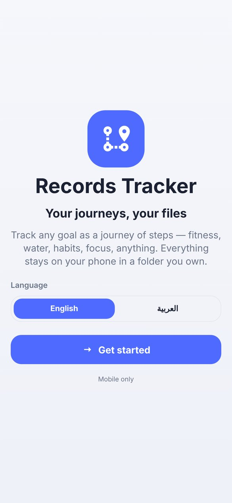
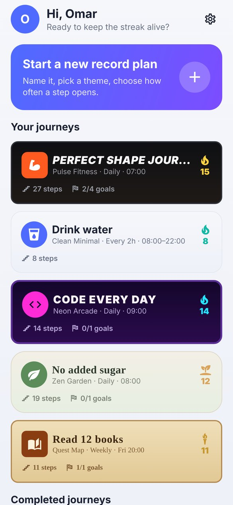
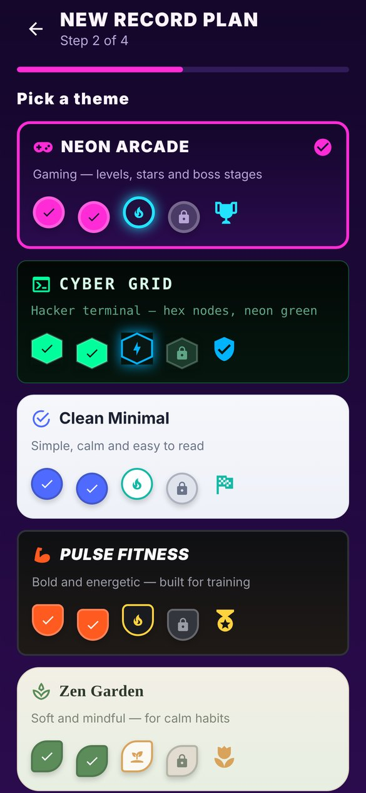
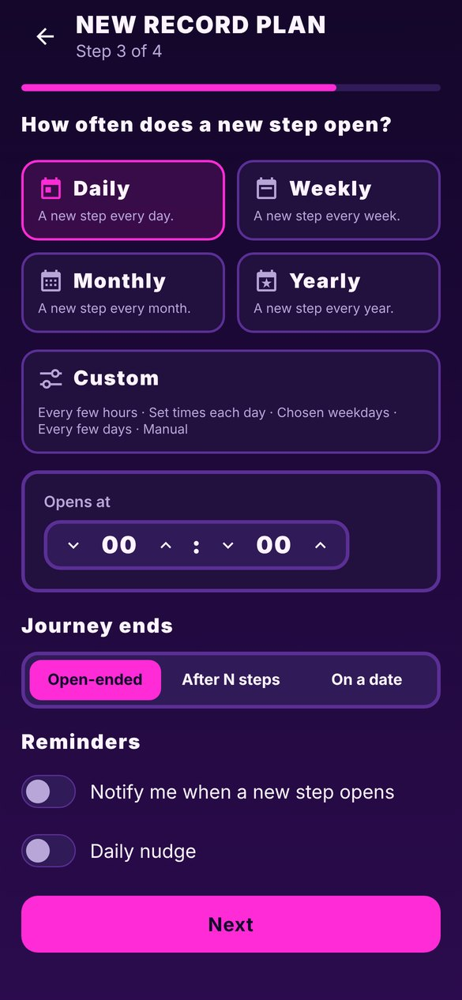
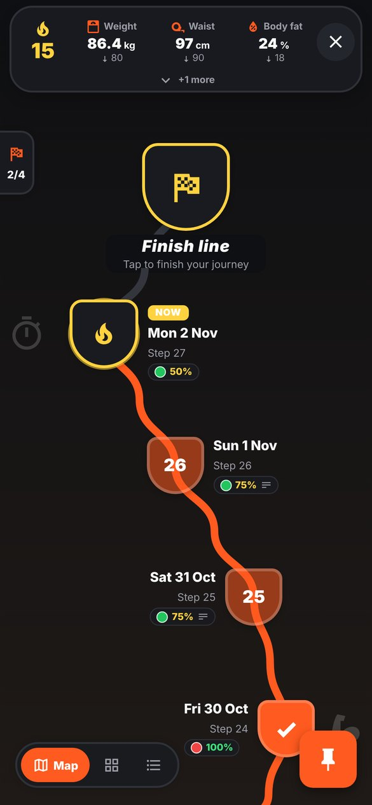
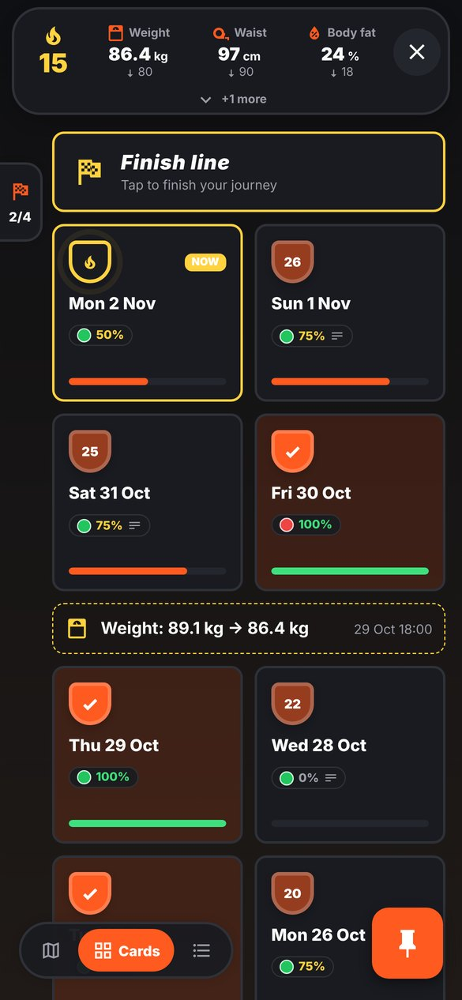
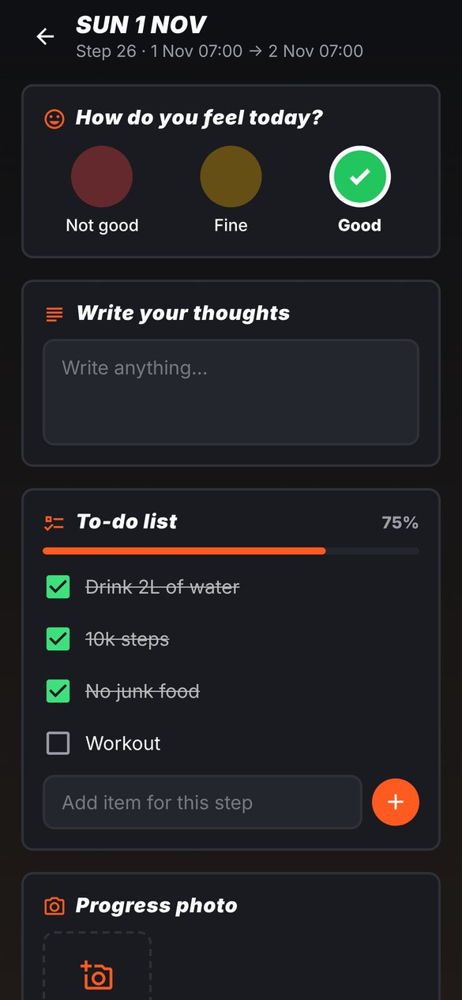
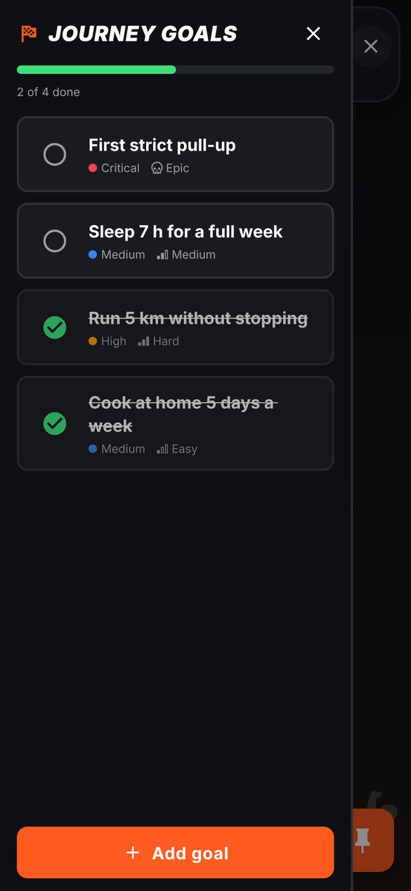
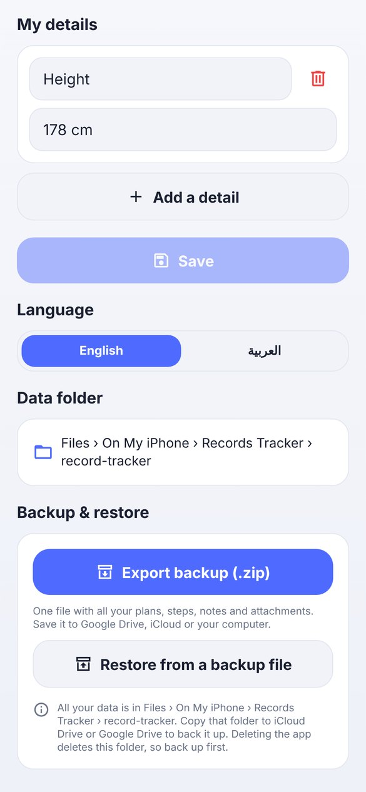

# Records Tracker — User guide

**English** · [العربية](user-guide.ar.md) · [← Back to README](../README.md)

Everything the app can do, screen by screen.

## Contents

- [1. First launch](#1-first-launch)
- [2. Home](#2-home)
- [3. Create a record plan](#3-create-a-record-plan)
- [4. The journey screen](#4-the-journey-screen)
- [5. Filling in a step](#5-filling-in-a-step)
- [6. Statuses](#6-statuses)
- [7. Journey goals](#7-journey-goals)
- [8. Editing a plan later](#8-editing-a-plan-later)
- [9. Finishing a journey](#9-finishing-a-journey)
- [10. Language and layout direction](#10-language-and-layout-direction)
- [11. Backup and restore](#11-backup-and-restore)
- [12. Reminders](#12-reminders)
- [13. Backup file (.zip)](#13-backup-file-zip)
- [14. Home-screen widget (Android)](#14-home-screen-widget-android)

## 1. First launch

<p align="center"></p>

1. **Choose a language.** English or العربية. You can switch later in Settings, and the layout flips instantly.
2. **Choose where your data lives.**
   - **Android:** tap **Choose folder** and pick a folder, for example *Documents*. The app
     creates a `record-tracker` folder inside it. The app can only access that one folder; it never
     asks for access to all your files.
   - **iOS:** nothing to pick. Your data goes to *Files › On My iPhone › Records Tracker ›
     record-tracker*.
   - **Restoring?** On Android, pick the folder that *contains* your old `record-tracker` folder,
     or the `record-tracker` folder itself. The app shows "Welcome back" and loads everything. On
     iOS, copy the folder into *Files › On My iPhone › Records Tracker* and tap **Check again**.
3. **Enter your name** (required).
4. **Tell us more (optional).** Add any number of details about yourself. You name the field and
   fill its value: height, birthday, goal weight, favourite sport… Tap **Skip for now** to do it
   later from **About me**.

## 2. Home

<p align="center"></p>

- **Hi, *name*.** Tap your avatar or the gear icon to open **About me / Settings** (profile
  details, language, data folder, backup help).
- **Start a new record plan.** The big button at the top.
- **Your journeys.** One card per active plan, drawn in that plan's theme. It shows the trigger,
  the current streak 🔥, the number of steps and how many goals are done.
- **Completed journeys.** Plans you finished, with their completion date.
- At the bottom: where your data is saved.

## 3. Create a record plan

<p align="center"> </p>

A four-step wizard:

1. **Name** the plan and optionally pick an **icon** from about 7,400 searchable icons (search
   works in English and common Arabic words such as ماء, وزن, رياضة).
2. **Pick a theme.** Each one has its own colours, node shape, path style and fonts:

   | Theme | Style |
   |---|---|
   | **Neon Arcade** | gaming: neon pink and cyan, round level nodes, stars, trophy finish |
   | **Cyber Grid** | hacker terminal: neon green, monospace, hexagon nodes |
   | **Clean Minimal** | simple and calm: white and blue, easy to read, list view by default |
   | **Pulse Fitness** | bold and energetic: orange on charcoal, shield nodes, medal finish |
   | **Zen Garden** | soft and mindful: sage and sand, leaf nodes, dotted path |
   | **Quest Map** | adventure: parchment, serif type, diamond nodes, treasure-chest finish |

3. **Choose how often a new step opens.**

   | Trigger | A new step opens… | Good for |
   |---|---|---|
   | Daily | every day at the time you set | most habits |
   | Weekly | on a weekday at a time | weekly reviews |
   | Monthly | on a day of the month (29–31 clamp to the month's last day) | budgets, check-ups |
   | Yearly | on a date each year | yearly goals |
   | **Custom: every few hours** | every N hours inside a window, e.g. every 2 h from 08:00 to 22:00 | drinking water |
   | **Custom: set times each day** | at times you list, e.g. 08:00, 14:00, 20:00 | medicine, meals |
   | **Custom: chosen weekdays** | only on the days you pick, e.g. Sun / Tue / Thu | gym days |
   | **Custom: every few days** | every N days | watering plants, check-ins |
   | **Custom: manual** | only when you tap **Add step** | event-driven tracking |

   Also on this page:
   - **Journey ends:** *Open-ended*, *After N steps* (e.g. a 30-day challenge) or *On a date*.
   - **Reminders:** *Notify me when a new step opens* and an optional *Daily nudge* at a time
     you choose.

4. **What will you fill in each step?** Start from a template: Mood check-in, Fitness day, Water
   intake, Habit tracker, Focus & study, or Blank. You can change it any time later.

Tap **Create plan**. A folder with the plan's name is created inside `record-tracker`, and you land
on the journey.

## 4. The journey screen

<p align="center"> </p>

```
┌────────────────────────────────────────┐
│  🔥 12   [ Weight ][ Waist ][ Mood ]  ✕  │  ← floating island
│                  ⌄ +2 more              │
└────────────────────────────────────────┘
 ⚑                 🏁  Finish line
 2/5               │
 (goals tab)       ●  NOW  Wed 28 Oct   ● 80% ✎ 🖼
                    ╲
                     ●  Tue 27 Oct      ● 100%
                    ╱
                   ⚐  Journey started

 [ Map | Cards | List ]                 📌
```

- **Streak** (top start). The number of steps in a row that you filled in. It grows bigger and
  changes colour at **10, 30, 90, 150, 300 and 500** (a crown at 500). Today's step doesn't break
  the streak until its time is over. Tap it to see your best streak and the next milestone.
- **Statuses** (centre). Up to **7** things you're tracking right now (see [Statuses](#6-statuses)).
- **✕** (top end). Back to Home.
- **Goals tab** (start edge). Opens the [goals drawer](#7-journey-goals).
- **The journey.**
  - **Map:** a winding, game-style path with the newest step at the top, under the finish line.
  - **Cards:** a grid of step cards.
  - **List:** a timeline.
  - Switch views with the bar at the bottom; the choice is saved per plan.
- **What a step shows without opening it:**
  - a **colour dot** for the mood you picked;
  - **completion %** for the first two to-do or number fields (`…` if there are more);
  - a **text icon** if you wrote anything;
  - **photo, video and file icons** if something is attached.
- **Step node states:**
  - **NOW:** the open step, pulsing.
  - **Filled:** the theme colour.
  - **Complete:** a check (a star in Neon Arcade).
  - **Missed:** greyed out.
- **Markers between steps:** status changes you chose to mark, and goals you achieved.
- **📌 Pin** (bottom end). Opens three actions: **Edit triggers**, **Edit step template** and
  **Edit plan**.
- **Add step**: appears next to the view switcher when the trigger is *manual*.

## 5. Filling in a step

<p align="center"></p>

Tap any step to open it. Its title is set automatically from the trigger: the date for daily
steps, "Week of …" for weekly ones, the month for monthly ones, and date and time for hourly ones.

| Field | How it works |
|---|---|
| **Mood / colour** | Tap one of the options (default: red *Not good*, yellow *Fine*, green *Good*). Tap again to clear it. Its colour becomes the step's dot on the map. |
| **Text** | Write freely. It saves when you pause typing or leave the field. |
| **To-do list** | Tick items. Add **extra items just for this step** with the field at the bottom (e.g. a special day); the template is unchanged. Remove an extra item with ✕. The bar shows % done. |
| **Number** | Use − / + or type a value. If the template has a target (e.g. 8 glasses), you see `6 / 8` and a progress bar. |
| **Yes / No** | Tap Yes or No; tap again to clear it. |
| **Photo** | **Add photo** offers the camera or your photo library. |

Below the template fields:

- **Notes.** Add as many as you like. Tap a note to edit or delete it.
- **Files & media.** Add photos and videos from your library (several at once), take a photo, or
  attach any file. They are **copied into the plan's `attachments` folder**, so they stay with
  your data. Tap a photo to view it full screen; tap a video or file to open it in another app.
  Long-press to delete.
- **Mark step complete.** Marks the step done even if not every item is ticked.

Filling a step counts toward your streak.

## 6. Statuses

Statuses are your **current state**, things that change over time like body weight, waist size,
belt colour or savings. Each has:

- a **name**, an **icon**, or both;
- a **type**: *number* or *text*;
- a **current** value, a **target** value and an optional **unit**;
- **Better when**: *lower* (weight), *higher* (savings), or *matches* (text such as "Blue belt").
  When the current value reaches the target it turns green ✓.
- **Main status (always shown)**: up to 3 statuses can be main.

How they're laid out in the island, for 0 to 7 statuses:

| Statuses | Island |
|---|---|
| 0 | an **Add status** button in the centre |
| 1–3 | all shown in the centre; the ⌄ handle opens a row with **+ Add status** |
| 4–7 | main ones first, so 3 are always visible; pull the ⌄ handle (it shows *+N more*) and the rest **slide down above them** |

**Updating a status:** tap it, change the value and tap **Save**.

1. The app asks **"Update this status?"**
2. If the current value changed, it asks **"Mark this update?"** Say **Yes** and a marker like
   *Weight: 92 kg → 90 kg* is added to the journey at that moment.

Every change is also kept in the status's **History**. Deleting a status asks for confirmation.

## 7. Journey goals

<p align="center"></p>

Open the goals drawer from the tab on the start edge. Goals are the things you must achieve
during this journey.

- **Add goal:** a title, optional details, **priority** (low / medium / high / critical) and
  **difficulty** (easy / medium / hard / epic).
- Goals are sorted with unfinished ones first, then by priority. The bar on top shows how many
  are done.
- **Tick the circle** to complete a goal. The app confirms, then asks **"Add this achievement to
  your journey?"** If you say yes, a trophy marker appears on the map.
- Tap a goal to edit or delete it. Every change asks for confirmation.

## 8. Editing a plan later

All three edits are behind the 📌 pin:

- **Edit triggers.** Change the trigger, the end rule or the reminders. **Steps you already have
  stay exactly as they are**: the step that is open now keeps its old trigger, and the new
  trigger applies from the next step. A marker is added to the journey, and the trigger history is
  listed on the page.
- **Edit step template.**
  - Add, remove, reorder and rename fields.
  - Edit mood options, including their colours; tap a swatch to change it.
  - Edit the pre-filled to-do items, and number units and targets.
  - Steps you already filled keep the fields they were filled with. The current step picks up the
    new template if it's still empty, and so does every new step.
- **Edit plan.**
  - Change the name, icon, theme or default view.
  - **Reopen** a finished journey.
  - **Delete** the plan, which removes its folder, steps, notes and files after a confirmation.

## 9. Finishing a journey

The **finish line** sits at the top of the map. Tap it whenever you're done. If the plan has an
end rule (after N steps or on a date), it lights up when you reach the end. The journey moves to
**Completed journeys** on Home and becomes read-only; you can reopen it from **Edit plan**.

## 10. Language and layout direction

- Switch between **English** and **العربية** in **About me → Language**. The whole app, including
  open sheets, mirrors **immediately**.
- In Arabic the app uses the **Cairo** typeface in every theme. Letter-spacing, italics and
  uppercase are turned off for Arabic, because letter-spacing breaks the joins between Arabic letters.
- Mixed text is handled. An English plan name inside an Arabic sentence, or "92 kg → 90 kg",
  keeps the right order in both languages.
- The game map is drawn the same way in both directions so the path and nodes stay aligned.
  Everything else mirrors: the streak, ✕, goals tab, pin and view switcher all swap sides in
  Arabic.

## 11. Backup and restore

Everything lives in one folder:

```
record-tracker/
  me.json                     your name and details
  me.backup.json
  <Plan name>/
    plan.json                 triggers, template, steps, statuses, goals, journey markers
    plan.backup.json
    attachments/<id>.<ext>    photos, videos and files you added
```

- **Back up:** copy the whole `record-tracker` folder to Google Drive, iCloud Drive, a computer…
  On Android use the Files app (long-press → Share or Copy); on iOS use Files.
- **Restore on a new phone:** put the folder back on the phone, then pick it during first launch
  (Android) or place it in *Files › On My iPhone › Records Tracker* (iOS). You can also switch
  folders later in **About me → Data folder**.
- **Safety:** every save writes a `.backup.json` copy first and then the main file, so a crash
  mid-save never leaves you without a complete copy.
- **iOS warning:** deleting the app deletes its Documents folder. Back up first.

## 12. Reminders

Reminders are local notifications, scheduled on the phone with no server involved.

- **When a new step opens** follows the plan's trigger (daily, weekly, set times, every few hours,
  and so on).
- **Daily nudge** sends a reminder at a time you choose.

You're asked for notification permission the first time you turn one on. Finished plans stop
reminding you.

## 13. Backup file (.zip)

<p align="center"></p>

Copying the folder works, but one file is easier to keep safe.

- **Export:** open **About me › Backup & restore** and tap **Export backup (.zip)**. The app puts
  your profile, every plan, all steps, notes and attachments into
  `records-tracker-backup-YYYY-MM-DD.zip` and opens the share sheet. Choose Google Drive, iCloud
  Drive, Files, email or any app.
- **Restore:** tap **Restore from a backup file** and pick the `.zip`. The app shows how many plans
  it contains and asks before changing anything.
  - A plan with the same name as one in the backup is **replaced** by the backup's version.
  - Plans that aren't in the backup **stay** as they are.
  - Your name and details are replaced if the backup has them.
- **New phone:** during first launch, after choosing where your data lives, the name page has
  **Restore from a backup file** too, so you can skip retyping everything.
- The file is a normal zip. You can open it on a computer; the plans are readable JSON.

## 14. Home-screen widget (Android)

Long-press an empty spot on your home screen, tap **Widgets**, and drag **Records Tracker** to
the screen. It shows up to four active journeys, those with an open step first. Each has:

- its **streak** 🔥 and name;
- the state of the open step: **✓ Step done**, a percentage, or **Step waiting for you**;
- a progress bar in the plan's theme colour.

The widget follows your phone's light or dark mode, and refreshes whenever you change something in
the app or leave it. The bottom line says when it was last updated. An iOS widget is planned.

